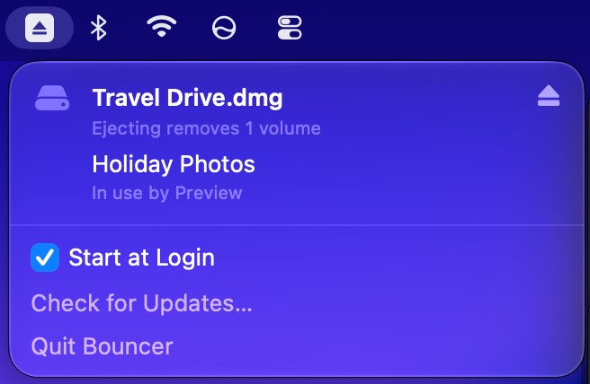

# Bouncer

Eject your drives, even when your Mac says you can't.

**[Download Bouncer](https://github.com/ofawx/bouncer/releases/latest/download/Bouncer.dmg)**. It's free and open source, and needs macOS 13 Ventura or later.

You've probably seen this one: "The disk couldn't be ejected because one or more programs may be using it." Your Mac won't tell you which programs. Bouncer will.

It sits in your menu bar and shows what's using each drive. Click eject, and if your Mac refuses, Bouncer closes whatever's in the way and tries again. If the drive still won't eject, Bouncer mounts it again and tells you what's holding on to it.

Bouncer doesn't check with you before closing things, so save your work first. Apps can still ask you to save, but background tasks are simply told to stop. Bouncer leaves anything in a Terminal window alone, can't close parts of macOS itself, and never forces a drive out.

## Install

Open the download and drag Bouncer to your Applications folder. It checks for updates by itself and asks before installing them.

Bouncer has no accounts, ads or analytics. Checking for updates is the only thing it does online.

## Help

[Open an issue](../../issues) or [get in touch](https://apps.ocf.sh/site/contact/). There's more on [apps.ocf.sh](https://apps.ocf.sh/apps/bouncer/), and in [CONTRIBUTING.md](CONTRIBUTING.md) if you'd like to work on the code.

## License

[MIT](LICENSE)
